# Domain Model

> [!IMPORTANT]
> This is a draft from before the project started, not a decision. It gives a shared starting point for grilling and specs. When an issue settles part of the domain, the glossary, the spec and the code win, and this diagram is updated to match.

The draft was made by Jonas and Jesper. Daniel and Dino have not approved it yet. It was moved here from `MTOGO/docs/brainstorm/domainmodel.md`. An online copy is on [mermaid.ai](https://mermaid.ai/d/4f7b7a63-16a6-4759-bc76-0d6c9b800673).

The account model is split into user (User and UserProfile), address (Address and PostalCode) and role (Role) features. The account portion is now implemented for [issue #13](specs/13-add-customer-accounts.md), with five entities and one optional profile address. The restaurant feature implements Restaurant, Menu and MenuItem for [issue #14](specs/14-show-restaurants-and-their-menus.md). The order feature implements Order, OrderLine, the OrderStatus enum and the status history for [issue #15](specs/15-place-and-pay-for-an-order.md). An order line copies the menu item's name and unit price when the order is placed. Payment is mocked and not stored. The remaining domains are still drafts. PostalCode stores city, code and country; Role uses CUSTOMER, RESTAURANT or DELIVERY_AGENT. Restaurant addresses remain a draft relationship.

```mermaid
classDiagram
direction TB

%% ######################################################
%%                    User Domain
%% ######################################################

class User {
    +Long id
    +String email
    +boolean isActive
    +String passwordHash
    +long sessionVersion
    +Role role
    +UserProfile profile
}

class UserProfile {
    +Long id
    +String firstName
    +String lastName
    +String phoneNumber
    +String preferredLanguage
    +Address address
}

class Address {
    +Long id
    +String street
    +PostalCode postalCode
    +boolean isDefault
}

class PostalCode {
    +Long id
    +String city
    +String code
    +String country
}

%% ######################################################
%%                    Business Domain
%% ######################################################

class PaymentService {
    +Long id
    +String companyName
    +String registrationNumber
    +boolean isActive
}

class Restaurant {
    +Long id
    +String name
    +boolean isAcceptingOrders
}

class Menu {
    +Long id
    +String name
    +String description
    +boolean isActive
    +Restaurant restaurant
}

class MenuItem {
    +Long id
    +String name
    +String description
    +BigDecimal price
    +String imageUrl
    +boolean isAvailable
    +Menu menu
}

%% ######################################################
%%                    Order Domain
%% ######################################################

class Order {
    +Long id
    +User customer
    +Restaurant restaurant
    +Address deliveryAddress
    +BigDecimal total
    +OrderChannel channel
    +OrderStatus status
    +moveTo(OrderStatus)
}

class OrderLine {
    +Long id
    +MenuItem menuItem
    +String name
    +Integer quantity
    +BigDecimal unitPrice
    +subtotal()
}

class OrderStatusChange {
    +Long id
    +OrderStatus status
    +Instant changedAt
}

class OrderStatus {
    <<enumeration>>
    PLACED
    ACCEPTED
    REJECTED
    READY
    PICKED_UP
    DELIVERED
}

class OrderChannel {
    <<enumeration>>
    WEBSITE
    APP
    TELEPHONE
}

class Payment {
    <<not stored>>
    +Long id
    +BigDecimal amount
    +String paymentStatus
    +confirmPayment()
    +failPayment()
}

class Commission {
    +Long id
    +BigDecimal orderAmountExVat
    +BigDecimal commissionAmount
    +BigDecimal serviceFee
    +calculateTotalFee()
}

%% ######################################################
%%                    Employee Domain
%% ######################################################

class Role {
    +Long id
    +RoleName name
}

class DeliveryAgent {
    +Long id
    +String employeeNumber
    +String vehicleType
    +boolean isAvailable
}

class Delivery {
    +Long id
    +String deliveryStatus
    +assignAgent()
    +markPickedUp()
    +markDelivered()
}

class Bonus {
    +Long id
    +BigDecimal baseAmount
    +BigDecimal totalAmount
    +String bonusStatus
    +calculateBonus()
}

%% ######################################################
%%                Feedback and Complaints
%% ######################################################

class OrderFeedback {
    +Long id
    +Integer foodRating
    +Integer deliveryRating
    +Integer overallRating
    +String comment
}

class Complaints {

}

%% ######################################################
%%                    Relationships
%% ######################################################

%% Users
User "1" *-- "1" UserProfile : has
User "1" --> "0..*" Order : places

%% Menus
Restaurant "1" *-- "0..*" Menu : offers
Menu "1" *-- "0..*" MenuItem : contains

%% Orders
Restaurant "1" --> "0..*" Order : receives
Order "1" *-- "1..*" OrderLine : contains
OrderLine "0..*" --> "1" MenuItem : references
Order "0..*" --> "1" OrderStatus : hasStatus
Order "1" *-- "1..*" OrderStatusChange : history
Order "0..*" --> "1" OrderChannel : arrivedThrough

%% Payments
Order "1" --> "0..1" Payment : hasPayment

%% User roles and delivery profiles
Role "1" --> "0..*" User : assignedTo
User "1" --> "0..1" DeliveryAgent : deliveryProfile

%% Deliveries
Order "1" --> "0..1" Delivery : hasDelivery
DeliveryAgent "1" --> "0..*" Delivery : performs

%% Bonuses
Delivery "1" --> "0..1" Bonus : earns
DeliveryAgent "1" --> "0..*" Bonus : receives

%% Commissions
Order "1" --> "0..1" Commission : generates

%% Address
Order "1" --> "1" Address : deliveredTo
Restaurant "1" --> "0..1" Address : hasA
UserProfile "1" --> "0..1" Address : hasA
Address "0..*" --> "1" PostalCode : hasA

%% Feedback
Order "1" --> "0..1" OrderFeedback : receives
User "1" --> "0..*" OrderFeedback : submits

%% Complaints
User "1" --> "0..*" Complaints : maySubmit
PaymentService "1" --> "0..*" Complaints : maySubmit
Order "0..1" --> "0..*" Complaints : mayConcern
```

