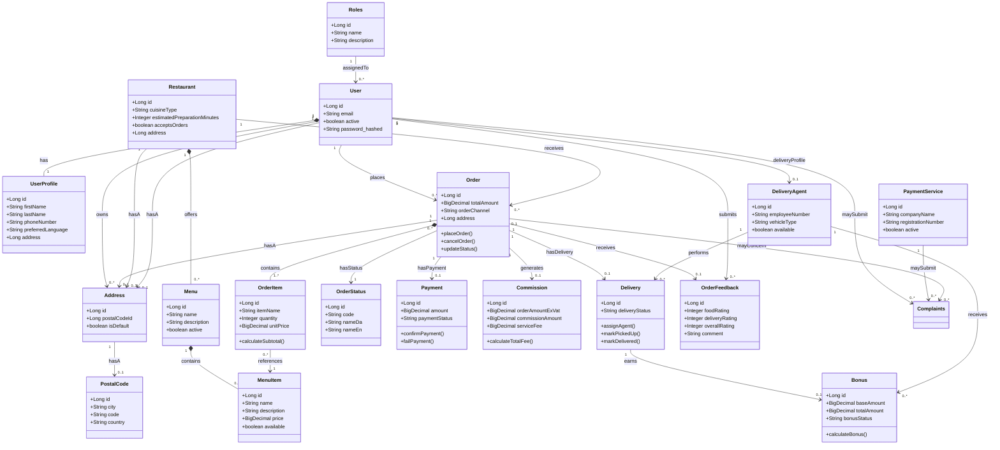

# Domain Model

> [!IMPORTANT]
> This is a draft from before the project started, not a decision. It gives a shared starting point for grilling and specs. When an issue settles part of the domain, the glossary, the spec and the code win, and this diagram is updated to match.

The draft was made by Jonas and Jesper. Daniel and Dino have not approved it yet. It was moved here from `MTOGO/docs/brainstorm/domainmodel.md`. An online copy is on [mermaid.ai](https://mermaid.ai/d/4f7b7a63-16a6-4759-bc76-0d6c9b800673).

